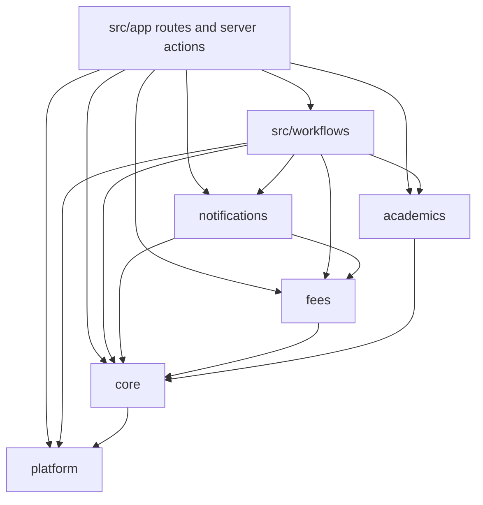
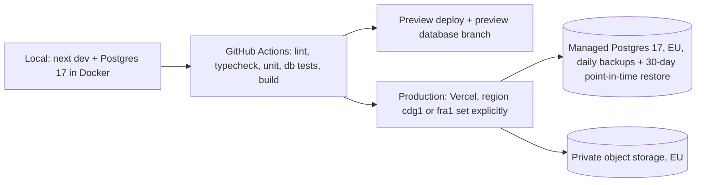

# Architecture Spine — E-skool platform

## Design Paradigm

**Modular monolith.** One Next.js app, one Postgres database. Code is split into modules by business area; each module has three layers: `domain` (pure TypeScript rules, no I/O), `application` (commands that change state, queries that read it) and `data` (Prisma access to the tables it owns). `src/workflows` composes commands of several modules in one transaction. Routes and server actions in `src/app` are thin: parse input, call one command, query or workflow, render.

| Module | Owns (PRD) |
| --- | --- |
| `platform` | Identity, Memberships, Schools, Subscriptions, support grants, verification registry (§4.1, FR-16, FR-47) |
| `core` | School settings and Modules state, structure and key dates, Pupils, Guardians, Enrolments, Staff, Audit log, i18n, documents, files (§4.2–4.4, §4.13–4.14) |
| `fees` | Funds, Fee plans, Charges, Discounts, Payments, Receipts, Payment delays, Send-home rules and confirmations, Cash sessions, dashboard, Baseline (§4.5–4.10) |
| `academics` | Subjects, Marks, Report cards (§4.11) |
| `notifications` | WhatsApp messages: outbox, templates, delivery statuses, reminder scheduling (§4.12, AD-18) |



## Invariants & Rules

### AD-1 — Modules own their tables and talk only through their public API

- **Binds:** all
- **Prevents:** a module reading or writing another module's tables and breaking its rules.
- **Rule:** each module exports `index.ts` with its commands and queries; nothing imports another module's `domain/` or `data/`. Imports follow the diagram above; `fees` and `academics` never import each other. Every Prisma model is listed once in `prisma/ownership.ts` with its owning module; a CI check fails when a module's `data/` touches a model it does not own. Cross-module reads use the owner's published query functions, which may return joined read shapes for lists (no N+1 loops across modules).

### AD-2 — Tenant isolation in the database, with a short list of global tables

- **Binds:** FR-2, §5.3, every table
- **Prevents:** a missing `where schoolId` leaking another School's data, and sign-in or verification being blocked by RLS.
- **Rule:** every table is either **tenant** or **global**, declared in `core/data/tenant-tables.ts` (the manifest). Tenant tables have a non-null `school_id`, a composite key `(school_id, id)` that foreign keys reference, and an RLS policy created by one migration helper: `school_id = current_setting('app.school_id')::uuid`, with `FORCE ROW LEVEL SECURITY`. The app's database role has no `BYPASSRLS`. Tenant access goes only through `withSchool(schoolId, tx => …)`, which opens a transaction and runs `set_config('app.school_id', …, true)` first. Global tables are exactly: identity and session tables (AD-13), `memberships`, `schools`, `subscriptions`, `auth_events`, `verification_codes`; they are reachable only from `platform`. CI fails when a model with `school_id` is missing from the manifest; export, restore, anonymise and the RLS test all iterate the manifest. A test per tenant table proves School B rows are invisible inside a School A transaction, and the first build ticket proves the `set_config` pattern under Prisma 7 interactive transactions.

### AD-3 — One write path per state change: `defineCommand`

- **Binds:** all mutations, FR-55
- **Prevents:** permission, module, audit or idempotency checks being skipped in one command and not another.
- **Rule:** every state change is a command built with `defineCommand({ name, permission, module, writes, schema, handler })`. The factory, in this order: resolves the session and active School, checks the permission (AD-5), the Module and the Subscription (AD-12), validates input with zod, checks the `requestId` (AD-15), opens `withSchool`, runs the handler, and writes the Audit row through `core.audit` in the same transaction. The handler receives `tx` and may only call its own module's `data/` or, inside a workflow, other commands with the same `tx`. Audit rows hold IDs and changed field names, never names or phone numbers; imports and system work use a `system` actor. Server actions call exactly one command or workflow; a CI check rejects Prisma write calls outside `data/` layers.

### AD-4 — Money is append-only, integer and gross

- **Binds:** FR-18 to FR-26, FR-34, FR-35, FR-37, §5.2
- **Prevents:** edited or deleted Payments, float rounding, Discounts counted twice, totals that disagree between screens.
- **Rule:** amounts are `integer` FCFA (TypeScript `number`, `Number.isSafeInteger`). A Charge stores its **gross** amount; Discounts are separate rows; "Charge due" (PRD Glossary) is always `netDue = gross − discounts`, computed in one SQL view `ledger_lines` and one TypeScript function used by every screen, export and PDF. Payments, Allocations, Discounts, Cash closings, opening balances and Audit rows are insert-only: a trigger rejects `DELETE` and every `UPDATE` except setting void fields once. Corrections are new rows. Credit is the unallocated part of Payments, computed on read. Opening balances imported at setup are `opening_paid` facts against Charges, not Payments, and take no Receipt number. Receipt numbers and School matricules come from one `counters` table, one row per (School, kind), locked `FOR UPDATE` in the same transaction.

### AD-5 — Permissions are a scoped server-side matrix

- **Binds:** FR-15, addendum §A
- **Prevents:** a hidden button whose action stays callable, Teachers seeing other Classes or any money, a Cashier voiding or discounting.
- **Rule:** `core/domain/permissions.ts` holds the one matrix (PRD FR-15): permission → Roles and a **scope** (`school`, `ownClasses`). `can(session, permission, resource)` checks Role and scope; scope IDs (Class and Subject IDs) come only from the session's Membership, resolved inside the transaction, never from request input. Every command and every query returning Balances or Marks calls it. Void, Discount, Payment delay, Send-home confirmation, Cash-gap approval and Guardian phone edits are Director-only permissions (Fedena revert privilege, Loyverse restricted discounts, Odoo closing approval). UI visibility reads the same matrix but never replaces the server check.

### AD-6 — Derived state is computed, never stored

- **Binds:** Balance, Due status, Collection rate, Payment delay Late/Broken/Honoured, the Send-home list candidates, missing Cash closing (FR-26, FR-30, FR-35, FR-36, FR-60)
- **Prevents:** a stored status drifting from its facts, and a job runner nobody watches.
- **Rule:** these values are computed at read time by pure functions in `fees/domain`, fed by `ledger_lines` and other SQL aggregates in `fees/data`, **as of a Douala date**. "As of D" counts Payments by `paid_on ≤ D`, Voids by `voided_on ≤ D`, Discounts by `granted_on ≤ D`, Instalments by their due dates. Only facts are stored: the Director's Send-home confirmation and each exclusion are facts (date, Class, Pupil, reason); the candidate list itself is computed. The only scheduled work in the MVP is WhatsApp sending (AD-18). If a read is slow, add a view or index, not a stored status. Values that must not change after the fact are snapshots (AD-14).

### AD-7 — Time is Douala time, dates are business dates

- **Binds:** §5.2, every due date and Checkpoint
- **Prevents:** a payment at 23:30 landing on the wrong day, and server-clock dates.
- **Rule:** business dates (due, paid, voided, granted, Evaluation periods, Checkpoints) are Postgres `date`; event times are `timestamptz`. "Today" comes only from `core/domain/clock.ts` `todayDouala()` (Africa/Douala); `new Date()` in business code fails lint outside `clock.ts`.

### AD-8 — Every visible string and document is bilingual by key

- **Binds:** FR-53, FR-54
- **Prevents:** hard-coded text in one Language, documents in the wrong Language.
- **Rule:** UI text lives only in `messages/fr.json` and `messages/en.json` (next-intl), with identical key sets; a test fails on a missing key. The interface Language comes from the User's preference (cookie, no locale in the URL). Document Language is chosen by one function `core.documentLanguage({ kind, guardianLanguage } | { kind: "report_card", classSubsystem })` implementing FR-54 and passed explicitly to every renderer. Amounts are formatted only by `formatFcfa()`, dates only by `formatDate()` (DD/MM/YYYY).

### AD-9 — Report card rules are versioned code, presentation is data

- **Binds:** FR-41 to FR-47
- **Prevents:** averages computed differently by the PDF and the screen, and Schools inventing grading rules.
- **Rule:** each Report card template is a TypeScript module in `academics/domain/templates/<id>@<version>/` implementing `computeResults(marks) → results` and `render(results, school, language)`. Screens and PDFs call `computeResults`; nothing else computes an average or rank. A changed rule is a new version; issued cards keep theirs (AD-14). A School stores only presentation choices. The MVP ships two standard templates (`fr-primary@1`, `en-primary@1`, marks with coefficients, PRD FR-41/42), each with a fixture test on a worked example Class.

### AD-10 — Public pages show only fixed, safe fields

- **Binds:** FR-24, FR-47, FR-64, §5.3
- **Prevents:** a scanned QR exposing a Balance or marks, a forged WhatsApp webhook, and verification code scattered across schools.
- **Rule:** the only unauthenticated routes are sign-in, `/v/[code]`, the WhatsApp webhook `/api/whatsapp/webhook` (accepted only with a valid Meta signature, AD-18) and static assets. Every issued document registers a code in the global `verification_codes` table (code → School, kind, document ID, status). `/v/[code]` calls one `SECURITY DEFINER` function that returns only: Report card — School, Pupil name, Class, Term, issue date, valid/replaced; Receipt — School, Receipt number, date, valid/voided. Codes are random, at least 10 base32 characters, and revocable. WhatsApp messages carry the Receipt number and amounts only for the linked Guardian, never a link to private data.

### AD-11 — Mark entry survives a dropped connection

- **Binds:** FR-43, FR-44, §5.1
- **Prevents:** teachers losing marks on a bad network, and stale offline values overwriting a reopened or locked Term.
- **Rule:** each Mark is saved by one idempotent upsert command keyed by (Enrolment, Subject, Evaluation period), enforced by a unique index. The entry screen queues unsaved values in `localStorage` with the Term's lock version and retries in order; the command refuses a value whose version is stale or whose Term is signed off, and the screen shows those cells as rejected. This is the only offline behaviour in the MVP.

### AD-12 — Module and Subscription guards read tenant state

- **Binds:** FR-3, FR-4
- **Prevents:** a switched-off Module or a suspended School still accepting writes, and `fees` needing platform tables.
- **Rule:** each School's Modules and Subscription state are mirrored by `platform` commands into the tenant table `school_settings` (owned by `core`), in the same transaction as the platform change. `defineCommand` reads it inside `withSchool`. Commands declare `writes: true | false`; a suspended School refuses every `writes: true` command and allows reads, exports and sign-in. Module dependencies are fixed: WhatsApp messages requires Fees.

### AD-13 — One identity per staff member, Memberships per School

- **Binds:** FR-1, FR-15, FR-16
- **Prevents:** one phone number becoming two identities, and sign-in blocked by RLS.
- **Rule:** better-auth's user, session, account and verification tables are global. A staff member has one user, identified by a normalised phone number (+237…) or an email. `memberships(user_id, school_id, roles, staff_member_id)` is global and is the only link from a person to a School; the session stores the active `school_id`, chosen at sign-in when there are several. Only staff sign in, with a password; Guardians are contacts, never users (parent sign-in removed 2026-10-30). Sign-in is rate-limited per phone and IP, locks for 15 minutes after 5 failures, and every attempt goes to the global `auth_events` table.

### AD-14 — Issued documents are snapshots

- **Binds:** FR-24, FR-40, FR-44, FR-46, FR-47
- **Prevents:** a signed-off Report card or a Receipt changing after it was handed over.
- **Rule:** issuing a Report card stores a row with its computed results, the template `id@version`, the Language and the Verification code; reprints read that row. Reopening a Term and reissuing creates a new row and revokes the old code. Receipts render only from immutable Payment and Allocation facts plus the Balance snapshot stored at recording. Settings that a decision depends on are copied onto the decision: Delay rules onto the Payment delay, the Send-home rule onto each Send-home confirmation, the Gap threshold onto each Cash closing.

### AD-15 — Money and issue commands are idempotent

- **Binds:** FR-22, FR-25, FR-28, FR-35, FR-46, FR-60
- **Prevents:** a double tap or a retried request on a slow network creating two Payments or two Receipts.
- **Rule:** every command with `writes: true` in `fees` and every issue command in `academics` takes a client-generated `requestId`; a unique index on (School, command, requestId) makes a repeat return the first result instead of writing again.

### AD-16 — Files are private and tenant-scoped

- **Binds:** FR-1 (logo, stamp), FR-37 (Baseline source file), generated PDFs
- **Prevents:** a guessed URL exposing another School's files.
- **Rule:** files live in one private bucket under `schools/<school_id>/…`; the database stores only the key. Files are served by a route that checks the permission (AD-5) and returns a short-lived signed URL. No public file URLs.

### AD-17 — Heavy work runs in client-driven chunks

- **Binds:** FR-11, FR-46, FR-56
- **Prevents:** imports, 350-card batches and full exports timing out on serverless, and an ad-hoc job system.
- **Rule:** an import is validated in one request (preview) and written in chunks of at most 200 rows, each chunk one command with its own `requestId`. Report card batches and exports are generated per Class (or per 50 rows) by successive requests driven by the browser, which shows progress and can resume. No background workers in the MVP other than WhatsApp sending (AD-18).

### AD-18 — WhatsApp goes through an outbox, never inside a money transaction

- **Binds:** FR-61 to FR-64, FR-57, §5.3
- **Prevents:** a slow or failed WhatsApp call blocking or rolling back a Payment, duplicate reminders, a message reaching a Guardian not linked to the Pupil, and silent failures.
- **Rule:** `notifications` owns `whatsapp_messages` (tenant table: type, guardian, pupils, template `name@language`, rendered fields, `trigger_key` unique per School, status queued/sent/delivered/failed/manual, provider message id, attempts, timestamps). Messages are only **enqueued**: a Payment confirmation by the `recordPayment` workflow in the same transaction as the Payment; a Send-home notice by the confirmation command; reminders by a daily job at 07:00 Douala that computes due candidates from `fees` queries (AD-6) and inserts rows with `trigger_key` = Pupil set + Tranche or Instalment + offset, so a rerun inserts nothing. Recipients are resolved from the Pupil's linked Guardians with WhatsApp consent at enqueue time. A sender drains the queue outside any money transaction: right after the request (`after()`) and every 15 minutes by Vercel Cron, calling the WhatsApp Cloud API with approved utility templates, with retries and backoff, then `failed` after 5 attempts. Delivery statuses arrive on `/api/whatsapp/webhook`, verified by the Meta signature. When the School has no connected WhatsApp number, messages stay `queued` and the screen offers the `wa.me` text (FR-64). The Cloud API token and phone number id are per School, encrypted at rest. Cron routes are protected by a secret.

## Consistency Conventions

| Concern | Convention |
| --- | --- |
| Naming | PRD Glossary terms in English for code (`Pupil`, `Guardian`, `Charge`, `PaymentDelay`, `Instalment`, `SendHomeConfirmation`, `CashSession`, `WhatsappMessage`); tables `snake_case` plural; commands verb-first (`recordPayment`); files `kebab-case.ts` |
| IDs | `uuid` primary keys (`gen_random_uuid()`); tenant FKs are composite `(school_id, id)`; human numbers come from `counters` (AD-4) |
| Money and dates | integer FCFA, gross on Charges; `date` for business dates; `timestamptz` for events; formatting only through `formatFcfa` / `formatDate` |
| Command result | `{ ok: true, data } \| { ok: false, error: { code, messageKey, field? } }`; `messageKey` exists in both Languages; commands never throw for expected failures |
| Validation | one zod schema per command input, shared by form and server |
| Cash closing | blind count: the counted amount is stored before expected and gap are computed and shown; then store expected, counted, gap and the Gap threshold as facts; a gap above the threshold leaves the closing awaiting Director approval; a Void after closing appears on the next closing by `voided_on` |
| UI | every screen is designed in Claude Design first; code implements the synced design with Tailwind |
| Forms | client forms submit through one `useCommand` hook (transition, result, `requestId`); inputs keep their values on failure |
| Logging | structured JSON to stdout; never log names, phone numbers, or amounts next to names |
| Config | environment variables read once in `src/config.ts`, validated with zod at startup |
| Tests | domain: Vitest unit; data, RLS and money: Vitest against a real Postgres; every command in `fees` has a test, including a call with another School's IDs that must fail |

## Stack

| Name | Version |
| --- | --- |
| Node.js | 24 LTS (maintenance) |
| TypeScript | 5.9.3 (TS 7 has no compiler API until 7.1; typescript-eslint not ready) |
| Next.js (App Router, server actions, `proxy.ts`) | 16.4.3 |
| React | 19.3.1 |
| PostgreSQL | 17, managed, EU region |
| Prisma ORM + `@prisma/adapter-pg` | 7.10.1 exact (npm `latest` is the 8.0 RC; do not take it) |
| better-auth | 1.7.14 |
| WhatsApp Cloud API (Meta Graph API, `fetch`, no SDK) | version pinned in `config.ts` at the epic-7 ticket |
| next-intl | 4.14.9 |
| zod | 4.6.7 |
| Tailwind CSS | 4.3.3 |
| @react-pdf/renderer | 4.9.0 |
| qrcode | 1.5.4 |
| Vitest | 5.0.5 |

## Structural Seed

```text
src/
  app/
    (auth)/            # staff sign-in, school picker
    (school)/          # staff screens, active school from session
    admin/             # Platform admin
    v/[code]/          # public verification page
    files/[...key]/    # permission-checked file access
    api/whatsapp/      # webhook (Meta signature) and cron senders (secret)
  workflows/           # cross-module commands (enrolPupil, importSchool, promoteClasses, recordPayment, confirmSendHome)
  modules/
    platform/  core/  fees/  academics/  notifications/
      index.ts         # public API (AD-1)
      domain/          # pure rules + unit tests
      application/     # defineCommand commands and queries
      data/            # Prisma access to owned models
  config.ts
messages/fr.json  messages/en.json
prisma/schema.prisma  prisma/ownership.ts  prisma/migrations/   # RLS, triggers, views in SQL migrations
tests/db/              # RLS, money and cross-school tests against Postgres
```

Core entities (names and links only):

```mermaid
erDiagram
  USER ||--o{ MEMBERSHIP : has
  SCHOOL ||--o{ MEMBERSHIP : grants
  SCHOOL ||--|| SCHOOL_SETTINGS : mirrors
  SCHOOL ||--o{ SCHOOL_YEAR : has
  SCHOOL_YEAR ||--o{ TERM : has
  TERM ||--o{ EVALUATION_PERIOD : has
  SCHOOL_YEAR ||--o{ CLASS : has
  LEVEL ||--o{ CLASS : groups
  GUARDIAN ||--o{ PUPIL_GUARDIAN : linked
  PUPIL ||--o{ PUPIL_GUARDIAN : has
  PUPIL ||--o{ ENROLMENT : has
  CLASS ||--o{ ENROLMENT : holds
  FUND ||--o{ FEE_ITEM : groups
  FEE_PLAN ||--o{ FEE_ITEM : has
  FEE_ITEM ||--o{ TRANCHE : split_into
  ENROLMENT ||--o{ CHARGE : owes
  TRANCHE ||--o{ CHARGE : defines
  CHARGE ||--o{ DISCOUNT : reduced_by
  RECEIPT ||--o{ PAYMENT : prints
  ENROLMENT ||--o{ PAYMENT : receives
  PAYMENT ||--o{ ALLOCATION : splits_into
  CHARGE ||--o{ ALLOCATION : receives
  ENROLMENT ||--o{ PAYMENT_DELAY : granted
  PAYMENT_DELAY ||--o{ INSTALMENT : has
  INSTALMENT }o--o{ CHARGE : reschedules
  TRANCHE ||--o| SEND_HOME_RULE : has
  SEND_HOME_CONFIRMATION ||--o{ SEND_HOME_EXCLUSION : excludes
  CASH_SESSION ||--o{ RECEIPT : collects
  CASH_SESSION ||--o| CASH_CLOSING : closed_by
  ENROLMENT ||--o{ MARK : receives
  SUBJECT ||--o{ MARK : for
  ENROLMENT ||--o{ REPORT_CARD : issued
  GUARDIAN ||--o{ WHATSAPP_MESSAGE : receives
```

Deployment and environments:



## Operations

| Concern | Decision |
| --- | --- |
| Database provider | Neon (Frankfurt) on a plan with 30-day point-in-time restore `[ASSUMPTION: to confirm at setup, against data-protection advice]` |
| Migrations | forward-only, run by `prisma migrate deploy` in the release step, never from a laptop |
| Rollback | Vercel instant rollback for code; migrations are additive so the previous build still runs |
| Per-School restore (FR-58) | restore to a scratch database, copy one School's rows by the manifest (AD-2); rehearsed before the pilot |
| Secrets | Vercel environment variables only; validated at startup (`config.ts`) |
| Monitoring | Vercel logs + an error tracker + an uptime check on sign-in and `/v` during school hours `[ASSUMPTION: tools chosen at setup]` |
| Owner | the builder; alerts go to the builder's phone |

## Capability → Architecture Map

| Capability / Area | Lives in | Governed by |
| --- | --- | --- |
| Schools, Subscriptions, Modules (FR-1–4) | `platform`, `core.school_settings` | AD-2, AD-12 |
| Structure, people, import, promotion (FR-5–14) | `core`, `workflows` | AD-2, AD-3, AD-17 |
| Sign-in, Roles (FR-15–16) | `platform`, `core` | AD-5, AD-13 |
| Fee plans, Charges, Discounts (FR-18–21) | `fees` | AD-3, AD-4 |
| Cash Payments, Receipts, Voids, Pupil account (FR-22–26) | `fees`, `workflows.recordPayment` | AD-4, AD-6, AD-14, AD-15 |
| Payment delays (FR-27, FR-28, FR-30) | `fees` | AD-3, AD-6, AD-14 |
| Send-home list (FR-59–60) | `fees`, `workflows.confirmSendHome` | AD-5, AD-6, AD-7, AD-15 |
| Cash closing (FR-34–35) | `fees` | AD-4, AD-7, AD-15 |
| Dashboard, Baseline, Term report (FR-36–40) | `fees` | AD-6, AD-7, AD-14 |
| Marks, Report cards, verification (FR-41–48) | `academics`, `platform.verification_codes` | AD-9, AD-10, AD-11, AD-14, AD-17 |
| WhatsApp payment records (FR-61–64) | `notifications` | AD-10, AD-18 |
| Bilingual (FR-53–54) | `core`, `messages/` | AD-8 |
| Audit, exports, consent, backups (FR-55–58) | `core`, Operations | AD-2, AD-3, AD-17 |

## Deferred

- **Database schema detail** (columns, indexes): owned by `prisma/schema.prisma` once written; the ERD and the ADs above bind it.
- **UI component kit and visual design:** designed in Claude Design; Tailwind is the only code binding.
- **Other messaging and payment APIs** (SMS, Mobile Money, bank): out of the MVP (PRD §6.3). WhatsApp is the only external API (AD-18).
- **Parent portal and parent sign-in:** removed 2026-10-30; if it returns, Guardians become Users through a new identity decision, not AD-13 as written.
- **Anonymisation mechanics** (FR-57): a logged maintenance command that rewrites personal fields only on tenant tables in the manifest; Audit rows need no change because they hold no personal data (AD-3). Detail in the FR-57 ticket.
- **School groups and multi-site:** later; Memberships already allow one person in several Schools.
- **Secondary, LMD, MINEFOP School types:** later modules plugging into `core` the way `academics` does; templates follow AD-9.
- **Caching and read replicas:** only after a measured slow read (AD-6).
- **Old code base:** not reused; archived on its own branch before the new tree is created (first build ticket).
